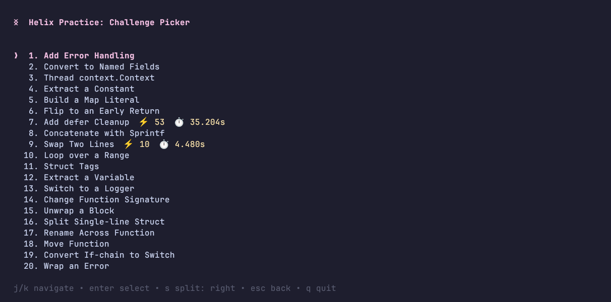
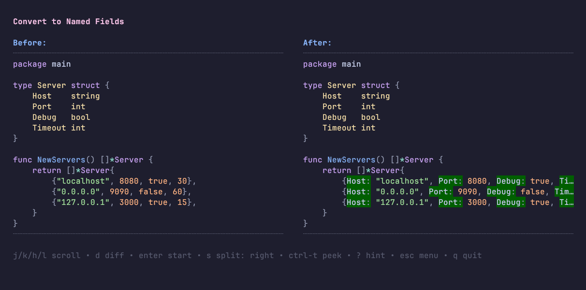
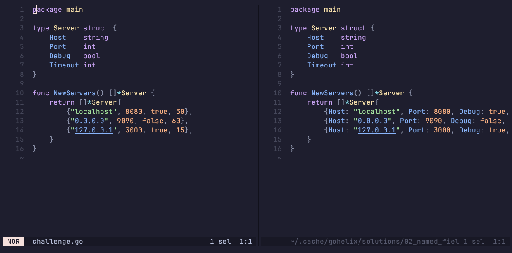
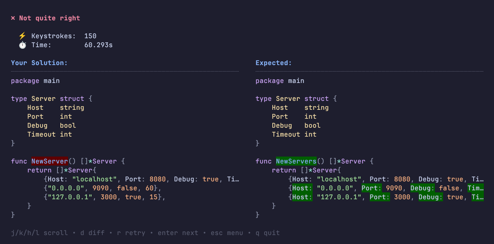

# gohelix

A terminal game for practicing [Helix](https://helix-editor.com) motions. Each
challenge gives you a `before.go` and an `after.go`; transform one into the
other in as few keystrokes as possible.

|        |  |
| :-------------------------------------------: | :----------------------------------------------: |
|               challenge picker                |            preview (difft diff view)             |
|  |   |
|       editing in helix with split view        |          result after a failed attempt           |

## Install

Try it without installing:

```sh
go run github.com/sollniss/gohelix@latest
```

Or install it:

```sh
go install github.com/sollniss/gohelix@latest
```

Or build from source:

```sh
go build -o gohelix .
```

Requires `hx` (Helix) on your `PATH`. Optional:
[`bat`](https://github.com/sharkdp/bat) adds syntax highlighting,
[`difftastic`](https://difftastic.wilfred.me.uk) adds an aligned diff view with
change highlighting (toggle with `d`).

## Usage

```sh
gohelix          # random challenge order (each appears once per cycle)
gohelix -c 9     # start at challenge 9
```

Keys:

- **Preview** — `enter` start • `j/k/h/l` scroll • `d` diff view • `?` hint • `s` solution split • `esc` picker • `q` quit
- **Picker** — `j/k` move • `enter` select • `s` solution split • `esc` back • `q` quit
- **Result** — `r` retry • `enter` next • `j/k/h/l` scroll diff • `d` diff view • `esc` picker • `q` quit

Arrow keys work wherever `j/k/h/l` do. The `d` and `s` choices persist across
sessions.

## Configuration

`config.json` in the config dir (`~/.config/gohelix/` on Linux). `diff_mode` and `solution_split` are written by the in-app toggles.

| Field                                           | Meaning                                                                                                       |
| ----------------------------------------------- | ------------------------------------------------------------------------------------------------------------- |
| `diff_mode`                                     | diff view: `"builtin"` or `"difft"`                                                                           |
| `solution_split`                                | `"off"`, `"left"`, `"right"`, `"top"`, `"bottom"`                                                             |
| `peek_key`                                      | peek toggle for split runs, e.g. `"ctrl-t"`                                                                   |
| `window_move_left` / `_right` / `_up` / `_down` | key sequences injected to move helix window focus, for remapped window-mode keys (defaults `"ctrl-w h"` etc.) |
| `quit_commands`                                 | extra quit detections for remapped quits: `[{"typed": "ZZ", "inject": ":qa enter"}]`                          |

Key sequences are space-separated tokens: `ctrl-x`, `esc`, `space`, `tab`,
`enter`, `up`/`down`/`left`/`right`; any other token is typed literally.

If `config.json` can't be read or parsed, the preview shows a warning and the
file is left untouched: the in-app toggles still work for the session but are
not saved until the file is fixed.
